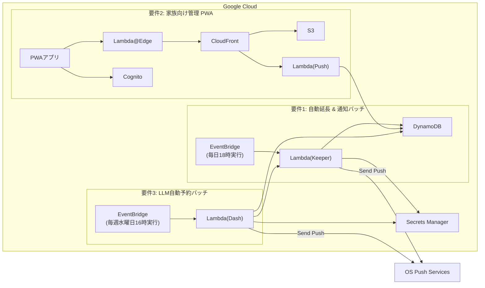

# Higalibra ~ 市立図書館 Web サービス自動化・管理システム ~

## 1. システム概要

本システムは、東○○市図書館の Web サイト（ELCIELO 製）を HTTP 通信経由で操作し、以下の自動化・視覚化を実現するサーバーレスシステムである。

1. **Keeper (自動延長・状態同期バッチ)**:  
毎日 1 回、家族 4 人分の貸出・予約状況を取得してファイルを更新し、返却期限が迫っている書籍を自動延長する。
また、予約状況が「取置済」、もしくは、返却期限が近づいた書籍がある場合、家族の Android 端末に Web Push 通知を送信する。

2. **Mesh (家族向け管理 PWA Web アプリ)**:  
家族 4 人分の最新の貸出・予約状況を一覧で確認できる PWA 対応の認証付き Web アプリケーションを提供する。  

3. **Dash (新着書籍の LLM 自動予約バッチ)**:  
毎週水曜日に新着書籍を取得し、 LLM を用いて Web 上の受賞歴やレビュー、紹介文などを調査・判定し、条件を満たす書籍を自動予約し、その結果を家族の Android 端末に Web Push 通知を送信する。

---

## 2. システムアーキテクチャ

### 2.1 全体構成図



---

## 3. 要件別機能設計

### 3.1 要件1: 貸出・予約状況取得 ＆ 自動延長処理（日次バッチ）

- **目的**: 図書館窓口での直接貸出/返却/予約の最新化、自動延長による返却遅延の防止、および期限接近アラートの判定。
- **起動トリガー**: EventBridge（毎日18時に実行）
- **実行基盤**: Lambda (Node.js)
- **処理フロー**:
  1. 図書館 Web サイトへスクレイピングを行い、家族 4 人分の貸出・予約状況を取得。
  2. 返却期限が指定日数以内に迫っており、かつ延長可能な書籍がある場合、自動延長の HTTP リクエストを送信。
  3. DynamoDB にある利用者状況 JSON ファイルを取得する。
  4. 最新データを DynamoDB に保存する。
  5. **取置済通知判定**: 最新データと DynamoDB から取得したデータを比較し、予約状況が「取置済」に変更されている書籍があれば、 Web Push 送信ロジックを呼び出し、該当ユーザーの端末へ通知。
  6. **返却期限通知判定**: 延長ができない状態で返却期限が3日前以内の書籍がある場合、Web Push 送信ロジックを呼び出し、該当ユーザーの端末へ通知。

### 3.2 要件2: 家族向け管理画面 (PWA & Web Push 対応)

- **目的**: 家族 4 人の状況を一画面で確認でき、ネイティブアプリ感覚でホーム画面から起動・Web Push 通知を受信可能にする。
- **構成要素**:
  - **フロントエンド**: CloudFront+S3（React による PWA / SPA 配信）
  - **ユーザー認証**: Cognito（ログイン認証、ID トークンによる API 認証）
  - **サブスクリプション登録API**: Lambda(Node.js) + DynamoDB（購読情報の保存）
- **PWA & Web Push 実装要件**:
  - **Service Worker**: キャッシュ制御およびバックグラウンドでの Push イベント受信・通知ダイアログ表示を担当。
  - **VAPID 認証**: Web Push 標準規格に基づき、Secret Manager に保持した VAPID 秘密鍵を用いて送信リクエストを署名。
  - **Push 購読登録フロー**:
    1. PWA 画面上でユーザーが「通知を有効にする」を操作。
    2. ブラウザの `PushManager` 経由で PushSubscription エンドポイントを取得。
    3. API 経由で PushSubscription 情報を DynamoDB（`UserSubscriptions` コレクション）に保存。

### 3.3 要件3: 新着書籍の自動予約

- **目的**: 新着本の中から好みの書籍を予約し、結果を即座に通知する。
- **起動トリガー**: EventBridge（毎週水曜日16時に実行）
- **実行基盤**: Lambda (Node.js)
- **処理フロー**:
  1. 新着リストを取得。
  2. S3 にある調査履歴を参照し、過去に調査済みの書籍をスキップ。
  3. 各書籍に対して Web Search Tool を実行し、賞やレビュー、紹介文を収集する。
  4. 検索結果テキストを LLM が解析し、「予約すべきか否か」を判定する。
  5. LLM の判定結果が「予約すべき」となった書籍に対して、図書館 Web サイトへ予約リクエストを送信する。
  6. 予約が成功した場合、`push` モジュール経由で「通知を家族の PWA 端末へ即時配信する。

---

## 4. 画面設計

各画面は、家族 4 人分の貸出・予約状況を一覧で確認できる PWA 対応の認証付き Web アプリケーションとして提供する。
各画面の遷移はボトムナビゲーションバーで行う。

### 4.1. ホーム画面（`/`）
- **概要**: 家族全体の利用状況サマリを表示
- **構成要素**:
  - **貸出サマリカード**: 総貸出冊数
    - 警告表示（返却期限が3日以内）：件数、該当書籍のタイトル、返却期限
  - **予約サマリカード**: 総予約冊数
    - 通知表示（取置済み）：件数、該当書籍のタイトル、取置期限
  - **クイックナビ**: バーコード表示画面へのショートカット

### 4.2. 貸出一覧画面（`/borrowed`）
- **概要**: 家族全員の現在借りている書籍一覧
- **構成要素**:
  - **フィルタ・ソート**: 利用者別絞り込み、返却期限順ソート
  - **貸出カードリスト**:
    - 利用者名（バッジ表示）
    - 書籍サムネイル画像、書籍名
    - 貸出日 / 返却期限（期限間近はハイライト表示）

### 4.3. 予約一覧画面（`/reservations`）
- **概要**: 予約中の書籍一覧と状態の確認
- **構成要素**:
  - **フィルタ・ソート**: 利用者別絞り込み、状態順（取置済優先）
  - **予約カードリスト**:
    - 利用者名、書籍名
    - 予約状態（待ち人数 / 取置済みステータス）
    - 予約日 / 取置期限（取置済みの場合のみ表示）

### 4.4. 利用者バーコード表示画面（`/barcode`）
- **概要**: 貸出時に提示する図書館利用証（バーコード）表示
- **構成要素**:
  - **利用者切り替えタブ/スワイプ**: 家族メンバーの切り替え
  - **バーコード表示エリア**: 一次元バーコード（SVG形式）を画面中央に拡大表示
  - **利用者情報**: 氏名、カード番号
  - **画面輝度固定機能**: 読み取りしやすいよう画面を明るく保つ注記

---

## 5. データ設計

PWA 画面で使用する利用者状況 JSON と調査履歴は S3 に保存する。  
Web Push 通知のサブスクリプションは DynamoDB に保存する。

### 5.1 利用者状況(`user_status.json`) in S3

{
    "lastUpdated": "<YYYY-MM-DDTHH:MM:SSZ>",
    "users": [
        {
            "userId": "<FamilyMemberID>",
            "name": "<FamilyMemberName>",
            "borrowedBooks": [
                {
                    "barcode": "<BookID>",
                    "status": "<BookStatus>",
                    "title": "<BookTitle>",
                    "author": "<BookAuthor>",
                    "genre": "<BookGenre>",
                    "loanDate": "<YYYY-MM-DD>",
                    "returnDate": "<YYYY-MM-DD>"
                }
            ],
            "reservedBooks": [
                {
                    "rank": "<BookID>",
                    "title": "<BookTitle>",
                    "reservedOn": "<YYYY-MM-DD>",
                    "holdExpiresOn": "<YYYY-MM-DD>"
                }
            ]
        }
    ]
}


### 5.2 Web Push サブスクリプション（`UserSubscriptions` コレクション） in DynamoDB

| ドキュメント ID | 属性 | 用途 |
| --- | --- | --- |
| `USER#<FamilyMemberID>#DEVICE#<DeviceID>` | `userId`, `deviceId`, `endpoint`, `keys`（p256dh, auth）, `updatedAt` | デバイスごとの Web Push 配信宛先 |

---

## 6. 外部サービス連携

### 6.1 図書館 サイトへのスクレイピング

Node.js の `/backend/scraping` パッケージにて実装する。

| command            | Arguments  | 概要                        |
| ------------------ | ---------- | --------------------------- |
| `getUserStatus`    | -          | 現在の貸出・予約状況を確認     |
| `getNewBooks`      | -          | 図書館の新着書籍リストを取得   |
| `extendLoan`       | `barcode`  | 書籍を延長                   |
| `reserveBook`      | `book_no`  | 書籍を予約                   |

### 6.2 Web Search Tool

Google AI Studio にて発行する Gemini Flash の API KEY を用いて、Gemini Flash API を呼び出す。  
@google/genai パッケージを用いて、LLM による Web 検索結果の解析を行い、予約すべき書籍か否かを判定する。

---

## 7. 技術スタック、および、CI/CD パイプライン

ソースコードおよびインフラ定義は **GitHub** で一元管理し、GitHub Actions によりデプロイを自動化する。

### 7.1 技術スタック

| レイヤー | 技術 |
| --- | --- |
| フロントエンド | React, TypeScript, Vite, TailwindCSS, PWA, Web Push, Service Worker |
| バックエンド | Node.js, TypeScript, AWS Lambda, DynamoDB, S3, CloudFront, Cognito |
| インフラ | AWS CloudFormation, GitHub Actions, NuShell |
| 外部サービス | | 図書館 Web サイト（ELCIELO）, Google Gemini Flash API |

### 7.2 リポジトリ構成

```
repository-root/
├── backend/
│   ├── dash/     # 新着書籍調査・自動予約バッチ
│   ├── keeper/   # 貸出・予約状況同期／自動延長バッチ
│   ├── push/     # サブスクリプション登録 API
│   └── scraper/  # 図書館 HTTP スクレイピング通信モジュール
├── frontend/     # 管理画面用 SPA/PWA コード (manifest.json, Service Worker 同梱)
└── infra.yaml    # CloudFormation による AWS インフラ定義
```

### 7.3 CI/CD パイプライン (GitHub Actions)

シェルは **NuShell/[setup-nu](https://github.com/marketplace/actions/setup-nu)** を使用し、以下の処理を実行する。

1. **cicd.yaml**:
   - フロントエンド（PWA）をビルドする。
   - Lambda（Keeper / Dash / Push API）をビルドする。
   - **CloudFormation** を実行し、AWS のリソースを更新。
